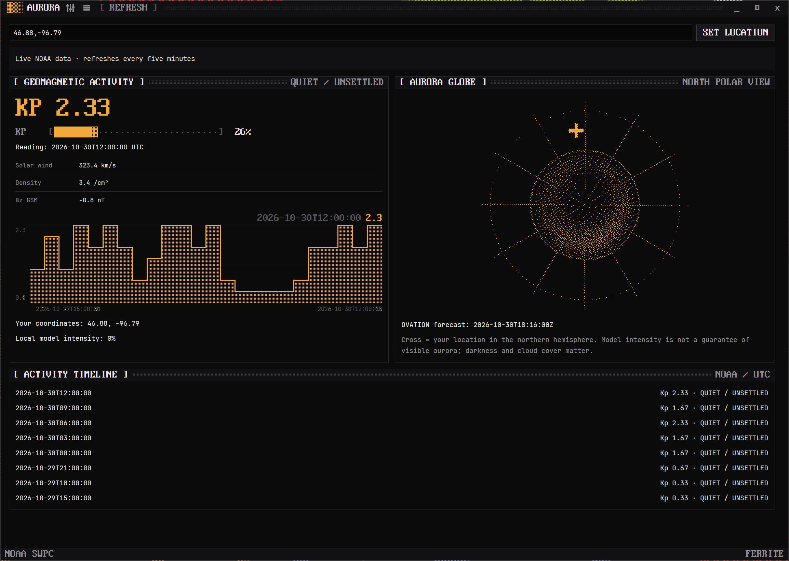

  

<h1 align="center">Aurora</h1>

  A native Ferrite dashboard for NOAA space weather: live Kp, solar wind, Bz and a dithered aurora globe.

  
  
  

Enter latitude,longitude to mark your location. Northern locations appear as a cross; the model intensity at either hemisphere is reported separately. NOAA refreshes every five minutes. Missing optional feeds remain unavailable while Kp continues to display. No API key is needed. Model intensity is not a visibility guarantee.

## Install

Download the Windows x64 zip from Releases, or install Aurora through Lodestone. SHA256SUMS.txt accompanies every release. Public main pushes automatically produce versioned releases. This initial release packages Windows; other platforms have not been validated.

The menu and Ctrl+Shift+P expose schemes, appearance, and refresh. Location and window position persist locally. Theme startup respects the Ferrite environment supplied by Lodestone.

## Develop

Rust 1.92 or newer: cargo run. Run cargo test and cargo clippy --all-targets. `--smoke` fetches the live NOAA feeds, and `--version` reports the package version.

Data: NOAA Space Weather Prediction Center, https://services.swpc.noaa.gov/ . Ferrite design is pinned to commit 4ddbb40. Apache-2.0.

## Settings

Open the sliders button in the title bar, press Ctrl+, or choose Settings from the command palette. All ten schemes, Dark/Light/System appearance, motion refresh rate (12 to 240 FPS), and row density apply immediately and persist per app. Save failures appear in Settings. Start with `--settings` to open the drawer directly. Ferrite launcher environment overrides take precedence at startup.

## Keys

| Keys | |
|---|---|
| <kbd>Ctrl</kbd>+<kbd>Shift</kbd>+<kbd>P</kbd> | Command palette |
| <kbd>Ctrl</kbd>+<kbd>,</kbd> | Settings |

---

  <picture>
    <source media="(prefers-color-scheme: dark)" srcset="docs/brand/heptagram-white.svg">
    
  </picture>

